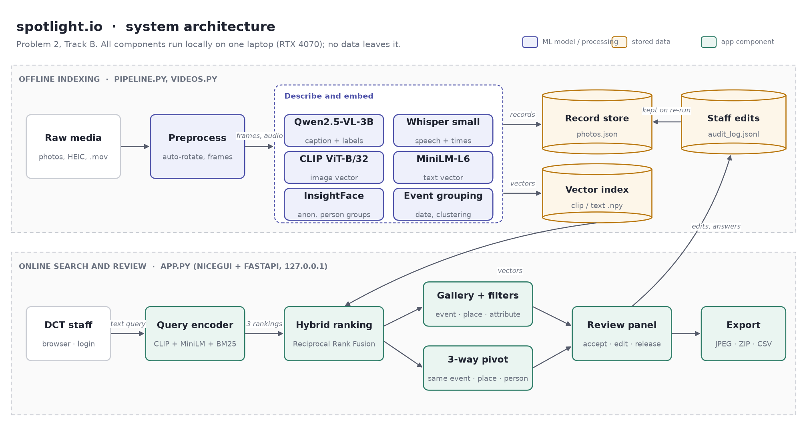

# spotlight.io

Photo and video search for Dreams Come True. Staff describe what they are looking for in plain words
and get the right photo, or the exact second in a video, in milliseconds. Everything runs on one
laptop, so no photo of a child ever leaves it.

Built at the AI4Good Hackathon 2026 (UNF FL-DSSG, Ponte Vedra Beach, 23 to 25 October 2026),
Problem 2, Track B: semantic search and curation.



## The problem

Dreams Come True has years of wish photos and phone videos. They are stored in folders by date,
with no captions or tags. Finding one photo for a newsletter or a grant report means scrolling for
an hour, and nobody can see at a glance which photos have a signed photo release.

## What it does

| | |
|---|---|
| Search in plain words | "child hugging a mascot at the theme park" finds matching photos by what is visible, what the caption means, and exact keywords |
| Search inside videos | Videos are split at scene changes and what is said is written down, so search opens the video at the right second |
| Three-way pivot | From any photo: same event, same place, or same person (anonymous groups, no names) |
| Filters | Event, person attribute, moment, year and photo release |
| Review | Staff accept or edit every AI description. Unsure labels are marked with a "?". Questions the AI must not guess, like "is this a family?", are answered by staff |
| Curation | Favorites, duplicate finder, bin with automatic emptying, downloads as JPEG or ZIP with captions |
| Access and audit | Staff and admin accounts, and a review log of every edit, download and removal |

## How it works

Offline, `pipeline.py` describes every photo once:

1. Photos are turned upright, and `videos.py` cuts videos into frames at scene changes.
2. Qwen2.5-VL writes a caption and picks activity, location, clothing, objects and visible moments as JSON.
3. CLIP and MiniLM turn each photo and its description into vectors. InsightFace groups faces into anonymous person groups. Whisper writes down speech in videos.
4. The records go to `outputs/photos.json`, the vectors to `.npy` files.

Online, `app.py` (NiceGUI on FastAPI) encodes each query with CLIP, MiniLM and BM25 and merges the
three rankings with Reciprocal Rank Fusion.

| Model | Job | License |
|---|---|---|
| [Qwen2.5-VL-3B-Instruct](https://huggingface.co/Qwen/Qwen2.5-VL-3B-Instruct), 4-bit | Captions and labels as JSON | Qwen Research License |
| [CLIP ViT-B/32](https://huggingface.co/openai/clip-vit-base-patch32) | Image vectors, zero-shot labels | MIT |
| [all-MiniLM-L6-v2](https://huggingface.co/sentence-transformers/all-MiniLM-L6-v2) | Text vectors | Apache 2.0 |
| [InsightFace buffalo_l](https://github.com/deepinsight/insightface) | Anonymous person groups | Non-commercial research |
| [Whisper small](https://huggingface.co/openai/whisper-small) | Speech in videos | MIT |

We compared Qwen2.5-VL with BLIP and Florence-2 on the same photos (`compare_models.py`). BLIP
invented objects and guessed family roles, Florence-2 guessed feelings. Qwen stuck to what is
visible and returned clean JSON, at about 5 seconds per photo on an RTX 4070 laptop GPU.

## Quick start

Needs Windows, Python 3.12 and ideally an NVIDIA GPU with 8 GB.

```
powershell -ExecutionPolicy Bypass -File setup.ps1
.venv\Scripts\activate
```

Put the photos in `data/raw/` (and videos in `data/videos/`), then:

```
python videos.py          # only if there are videos
python pipeline.py        # describes everything, about 5 s per photo
python app.py             # open http://127.0.0.1:8080
```

The first start asks for an admin account. New photos can later be added from the app (Add photos).
Running `pipeline.py` again keeps staff edits, photo releases and answers. More detail in
[SETUP.md](SETUP.md).

## Results and limitations

Tested on 128 photos and 9 videos (70 searchable video moments) from Dreams Come True.

- Describing takes about 5 seconds per photo, search takes milliseconds.
- Search quality is measured with `evaluate.py` (Recall@5, Recall@10, MRR) on hand-labelled queries in `eval/test_queries.csv`.
- Captions can miss small objects, and CLIP is weak on small details and colors.
- Face grouping is less accurate for young children, some skin tones and side views.
- Video moments are described as still frames, so motion is not captured.

The full list is in the [system card](docs/SYSTEM_CARD.md).

## Privacy

The photos show children, some of them seriously ill.

- Nothing is sent to a cloud service. The app only listens on 127.0.0.1.
- No photos, videos, captions, transcripts or vectors are in this repository. `.gitignore` blocks `data/`, `outputs/` and all image and video formats.
- Original file names can contain names, so the app never shows them and exports leave them out.
- The AI never names anyone and never guesses emotions, health or relationships. Person groups are anonymous (P01, P02) and can be switched off with `python pipeline.py --no-faces`. The organizers approved face grouping for this event.
- The app log keeps counts and timings only, never search words or captions.

Details on consent, access control and retention are in the
[data-governance note](docs/SYSTEM_CARD.md#5-data-governance-note).

## Project structure

```
app.py                  web app: search, pivots, review, accounts, bin
pipeline.py             describes photos and builds the index
search.py               hybrid search, pivots, review and audit log
videos.py               video frames and Whisper speech
accounts.py, applog.py  logins and the app log
evaluate.py             search quality (Recall@k, MRR)
compare_models.py       caption model comparison
caption_testing/        caption experiments (Isak)
make_sample_output.py   sample structured output for the submission
make_architecture.py    the architecture diagram
docs/                   system card, data-governance note, diagram
```

## Team

Matty Jatta, Isak Rodung and Joshua, AI4Good Hackathon 2026.

Thanks to Dreams Come True for the photos and the problem, and to the UNF FL-DSSG organizers and
mentors.

## License

The code is for the AI4Good Hackathon 2026 and Dreams Come True. The models keep their own licenses
(table above). Qwen2.5-VL and InsightFace are for non-commercial use.
